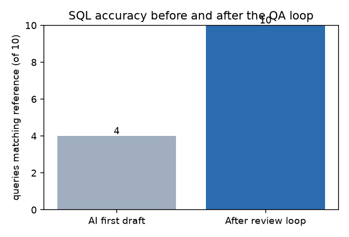

# AI-assisted analytics workflow with SQL QA

**Synthetic data.** A small e-commerce warehouse (3,000 customers, ~4,100 orders, refunds, guest checkouts) in DuckDB.
No employer data. The question this project answers: **how do you use an AI assistant to write SQL fast and still trust the numbers?**

## Workflow
1. Write the question with its definition (what counts as revenue, who is a customer).
2. Have an AI assistant (Claude) draft the SQL from the question text and schema alone.
3. Run it through the harness (`harness.py`): read-only guard, executes, same columns and rows as a reviewed reference query
   (order-insensitive, numeric tolerance), and a reconciliation check against the source tables.
4. Diagnose each failure, fix it, re-grade, and keep the cause so the same trap is checked next time.

The AI drafts in this repo were written in a chat session, not by an automated API call inside the harness. The reference SQL was written
and reviewed by hand. Results below are from actually running the harness.

## Results (4/10 first drafts correct, 10/10 after review)
| id | question | first draft | after review |
|---|---|---|---|
| Q1 | Monthly net revenue = completed order amount minus refunds on those or... | value_mismatch in net_revenue | PASS |
| Q2 | How many customers have at least 2 completed orders? (Orders with no c... | value_mismatch in customers | PASS |
| Q3 | Average completed-order value by customer country (exclude guest order... | PASS | PASS |
| Q4 | Top 5 products by revenue (qty x price) on completed orders. | value_mismatch in product_id | PASS |
| Q5 | Monthly refund rate = refunded amount / completed order amount, by mon... | value_mismatch in refund_rate | PASS |
| Q6 | By signup month: share of customers with a completed order who placed ... | value_mismatch in repeat_rate | PASS |
| Q7 | Median days between a customer's first and second completed order (cus... | PASS | PASS |
| Q8 | Completed orders and revenue by customer plan (exclude guest orders). | PASS | PASS |
| Q9 | Of customers whose FIRST completed order had a discount (>0), how many... | value_mismatch in customers | PASS |
| Q10 | Share of customers (with at least 1 completed order) whose second comp... | PASS | PASS |

Why the first drafts failed:
- **Q1**: value_mismatch in net_revenue. Cause: join fan-out: an order with 2 refunds is counted twice, inflating revenue.
- **Q2**: value_mismatch in customers. Cause: NULL customer_id (guest checkout) forms its own group and is counted as a customer.
- **Q4**: value_mismatch in product_id. Cause: forgot the completed-orders filter (cancelled and pending items counted).
- **Q5**: value_mismatch in refund_rate. Cause: same fan-out inflates the denominator.
- **Q6**: value_mismatch in repeat_rate. Cause: denominator included customers with no completed order (definition drift).
- **Q9**: value_mismatch in customers. Cause: counted any later order, not specifically the first one, and kept guest orders.

Reconciliation guard: true net revenue from the source tables is **528,808.52**. The first-draft Q1 totals **565,533.72**
(overstated by 36,725.20); the revised query totals **528,808.52**.



## What I take from this
- Fluent-looking SQL is often wrong in exactly the places that matter: join fan-out, NULL keys, missing status filters, and
  unstated denominators. A query that runs is not a query that is right.
- The cheap, high-value checks are reconciliation to source totals and row-count sanity, not reading the SQL harder.
- Writing the metric definition first removes most of the ambiguity before the AI sees the question.

## Limits
- Ten questions on one small schema; this shows a method, not a benchmark of any model. The first drafts were written as representative first-pass attempts in a chat session, so the pass rate is a worked example, not a measured error rate for any model.
- A comparison to a reference query only works when the reference is itself correct, so reference SQL needs human review.

## Run it
```
pip install duckdb pandas numpy matplotlib
python build_db.py
python harness.py
```
